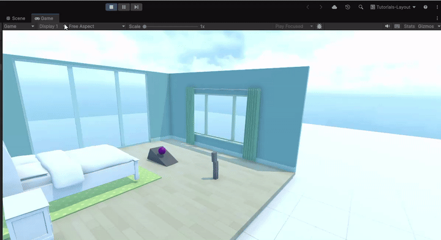

# Bedroom Project

Unity 3D interior environment project featuring customized room assets, prefabs, materials, and physics-driven block interactions.

## Demonstration Video & Preview

> [!NOTE]
> **Screen Recording:** [Watch full screen recording (BLOCKS.mp4)](./BLOCKS.mp4) *(GitHub provides an interactive video player when viewing the file directly)*.

---

## Features

- **Interactive Room Setup**: Detailed bedroom scene with furniture, decor, and colliders.
- **Physics Interaction**: Rigidbody blocks with custom physics materials reacting to forces and gravity.
- **Prefabs & Materials**: Modular prefab components and custom textured materials.

---

## Screenshots

| Environment View | Setup Detail |
|:---:|:---:|
| .png) |  |
