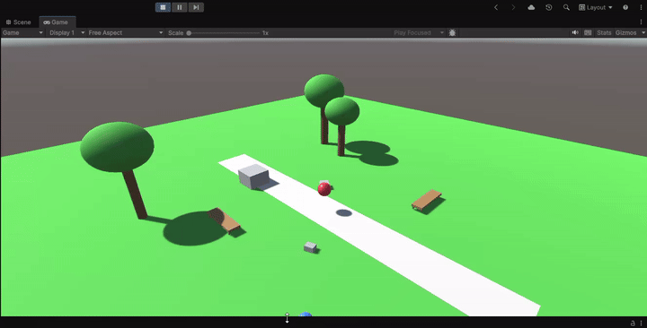

# Game-dev

Repository containing Unity Game Development projects and physics simulations.

---

## Projects Overview

### 1. [Park Physics](./parkphysics/)

Unity physics simulation environment featuring bouncy physics materials, rigidbodies, and environment interaction.

- **Folder**: [`parkphysics/`](./parkphysics/)
- **Screen Recording**: [ball bouncing.mp4](./parkphysics/ball%20bouncing.mp4)

---

### 2. [Bedroom](./Bedroom/)

Unity 3D bedroom interior environment featuring interactive physics blocks, colliders, and prefabs.

- **Folder**: [`Bedroom/`](./Bedroom/)
- **Screen Recording**: [BLOCKS.mp4](./Bedroom/BLOCKS.mp4)
